# Lab 4 -- Secure Connect and Communication Platform

A Node.js application demonstrating user authentication, role-based
access control, protected notes, event-driven logging, and
JWT-authenticated real-time chat.

## Features

-   **User signup:** Registers users and hashes passwords using
    `bcrypt`.
-   **User login:** Verifies credentials and issues a JSON Web Token
    (JWT).
-   **Authentication middleware:** Protects routes by validating Bearer
    tokens.
-   **Role-based access control (RBAC):** Restricts the admin users
    endpoint to accounts with the `admin` role.
-   **Secure Notes API:** Users can create, view, update, and delete
    their own notes.
-   **Event-driven logging:** Uses Node.js `EventEmitter` to log signup,
    login, note creation/deletion, and chat-message events.
-   **Real-time chat:** Uses Socket.IO and validates a JWT during the
    socket connection.
-   **Static chat page:** Serves the browser interface from the `public`
    folder.

## Technology Stack

-   Node.js
-   Express.js
-   bcrypt
-   JSON Web Token (`jsonwebtoken`)
-   dotenv
-   Socket.IO

## Project Structure

``` text
lab4-secure--connect/
├── public/
│   └── index.html
├── screenshots/
├── .env.example
├── .gitignore
├── package.json
├── package-lock.json
├── README.md
└── server.js
```

## Prerequisites

Install:

-   [Node.js](https://nodejs.org/) (npm is included)
-   [Visual Studio Code](https://code.visualstudio.com/) or another code
    editor
-   Thunder Client extension in VS Code (or another API client) to test
    the REST APIs

Check that Node.js and npm are installed:

``` bash
node -v
npm -v
```

## Setup and Run

1.  Extract the project ZIP file.

2.  Open the `lab4-secure--connect` folder in VS Code.

3.  Open the integrated terminal in that folder.

4.  Install dependencies:

    ``` bash
    npm install
    ```

5.  Create a `.env` file in the project root. Copy the contents of
    `.env.example` and set your own long, random JWT secret:

    ``` env
    PORT=3000
    JWT_SECRET=replace_with_a_long_random_secret
    JWT_EXPIRES_IN=1h
    ```

6.  Start the server:

    ``` bash
    npm start
    ```

7.  Open the chat page in your browser:

    <http://localhost:3000>

Keep the terminal running while using the application. Stop the server
with `Ctrl + C`.

## API Testing with Thunder Client

All REST API requests use this base URL:

``` text
http://localhost:3000
```

For JSON requests, choose **Body → JSON** in Thunder Client.

### 1. Sign up

-   **Method:** `POST`
-   **URL:** `/auth/signup`
-   **Body:**

``` json
{
  "username": "sanchita",
  "password": "123456",
  "role": "user"
}
```

A successful signup returns HTTP `201` and a user object. Passwords are
stored as bcrypt hashes, not as plain text.

For the lab demonstration, the signup route accepts `role: "admin"` to
create an admin account. In a real application, users must not be
allowed to choose their own privileged role during public signup.

### 2. Log in

-   **Method:** `POST`
-   **URL:** `/auth/login`
-   **Body:**

``` json
{
  "username": "sanchita",
  "password": "123456"
}
```

A successful login returns a JWT token. Copy this token for protected
requests.

### 3. Add the token to protected requests

In Thunder Client:

1.  Open the **Auth** tab.
2.  Select **Bearer**.
3.  Paste the token returned by login.
4.  Send the request.

The equivalent HTTP header is:

``` text
Authorization: Bearer YOUR_JWT_TOKEN
```

### 4. View the logged-in user's profile

-   **Method:** `GET`
-   **URL:** `/profile`
-   **Authentication:** Bearer token required

### 5. View all users (admin only)

-   **Method:** `GET`
-   **URL:** `/admin/users`
-   **Authentication:** Bearer token for an account with the `admin`
    role required

A normal user receives HTTP `403 Forbidden`.

### 6. Create a note

-   **Method:** `POST`
-   **URL:** `/notes`
-   **Authentication:** Bearer token required
-   **Body:**

``` json
{
  "title": "My First Note",
  "content": "This is my first secure note."
}
```

A successful request returns HTTP `201` and the created note, including
its ID.

### 7. Get all notes belonging to the logged-in user

-   **Method:** `GET`
-   **URL:** `/notes`
-   **Authentication:** Bearer token required

The response includes the number of notes and the current user's notes.

### 8. Get one note

-   **Method:** `GET`
-   **URL:** `/notes/1`
-   **Authentication:** Bearer token required

Replace `1` with the ID returned when the note was created.

### 9. Update a note

-   **Method:** `PUT`
-   **URL:** `/notes/1`
-   **Authentication:** Bearer token required
-   **Body:**

``` json
{
  "title": "Updated Note",
  "content": "The note content has been updated."
}
```

The title and/or content can be supplied.

### 10. Delete a note

-   **Method:** `DELETE`
-   **URL:** `/notes/1`
-   **Authentication:** Bearer token required

Replace `1` with the note ID. A successful request returns a
confirmation message.

### API Summary

  Feature            Method   Endpoint         Access
  ------------------ -------- ---------------- ---------------
  Sign up            POST     `/auth/signup`   Public
  Log in             POST     `/auth/login`    Public
  View profile       GET      `/profile`       Authenticated
  List users         GET      `/admin/users`   Admin only
  Create note        POST     `/notes`         Authenticated
  List own notes     GET      `/notes`         Authenticated
  Get one own note   GET      `/notes/:id`     Authenticated
  Update own note    PUT      `/notes/:id`     Authenticated
  Delete own note    DELETE   `/notes/:id`     Authenticated

## Real-Time Chat

1.  Start the server with `npm start`.
2.  Open <http://localhost:3000>.
3.  Sign in with an account already registered through `/auth/signup`.
4.  Open the same address in another browser window or an incognito
    window.
5.  Sign in as a second registered user.
6.  Send a message from either window. Connected users receive chat
    messages in real time.

The browser client sends the login JWT to Socket.IO during connection.
The server verifies the token before accepting the socket connection.

## Event-Driven Logging

The application uses Node.js `EventEmitter`. Relevant events are printed
in the server terminal:

-   `user:signup`
-   `user:login`
-   `note:created`
-   `note:deleted`
-   `chat:message`

Socket connection and disconnection messages are also logged.

## Important Notes and Limitations

-   **In-memory storage:** Users and notes are stored in arrays in
    `server.js`. They are lost when the server process restarts. This
    project does not use a persistent database.
-   **Signup before login:** A user must be registered before logging
    in. If the server restarts, register the user again.
-   **Token expiry:** The JWT expiry is controlled by `JWT_EXPIRES_IN`
    (default: `1h`). Log in again to obtain a new token after expiry.
-   **Notes ownership:** The API checks the authenticated user's ID when
    retrieving, updating, or deleting a note.
-   **Demo admin role:** The current signup implementation allows the
    caller to request the `admin` role. This is for lab demonstration
    only and is not suitable for production.
-   **Development use:** Use a strong, private JWT secret and do not
    commit `.env` to version control.

## Troubleshooting

**Connection refused**

-   Confirm the server is running in the terminal.
-   Check that it displays `Server is running on port 3000`.
-   Confirm the request uses `http://localhost:3000`.

**401 Unauthorized -- Invalid username or password**

-   Sign up the user first.
-   Check the username and password.
-   Remember that in-memory users are cleared when the server restarts.

**401 Unauthorized -- Token missing / invalid or expired**

-   Add the login token under Thunder Client → Auth → Bearer.
-   Log in again if the token has expired.

**403 Forbidden**

-   The route is restricted to admin users. Sign in with an account
    created with the `admin` role for the lab demonstration.

**Note not found**

-   Use the note ID returned by the create-note request.
-   Make sure you are using the same user's token that owns the note.

## Screenshots

Add your Thunder Client and browser screenshots to the `screenshots/`
folder. The following names can be used:

1.  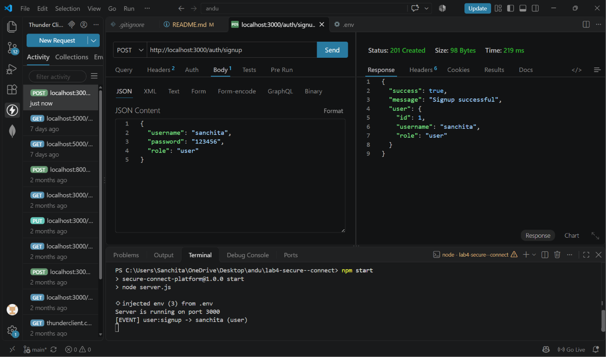
2.  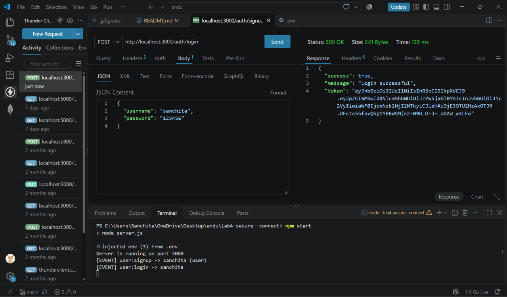
3.  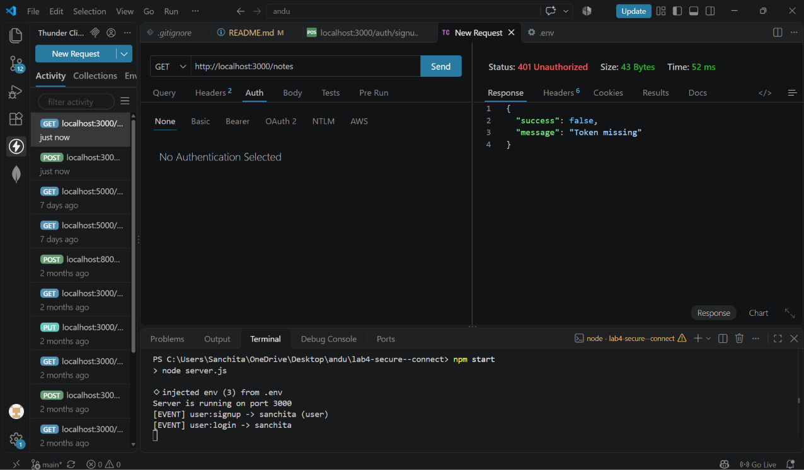
4.  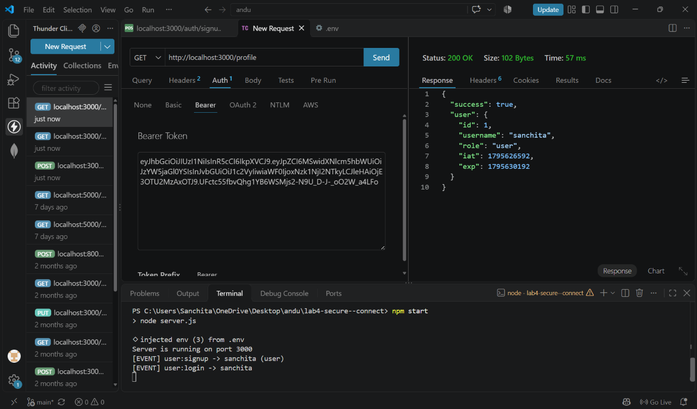
5.  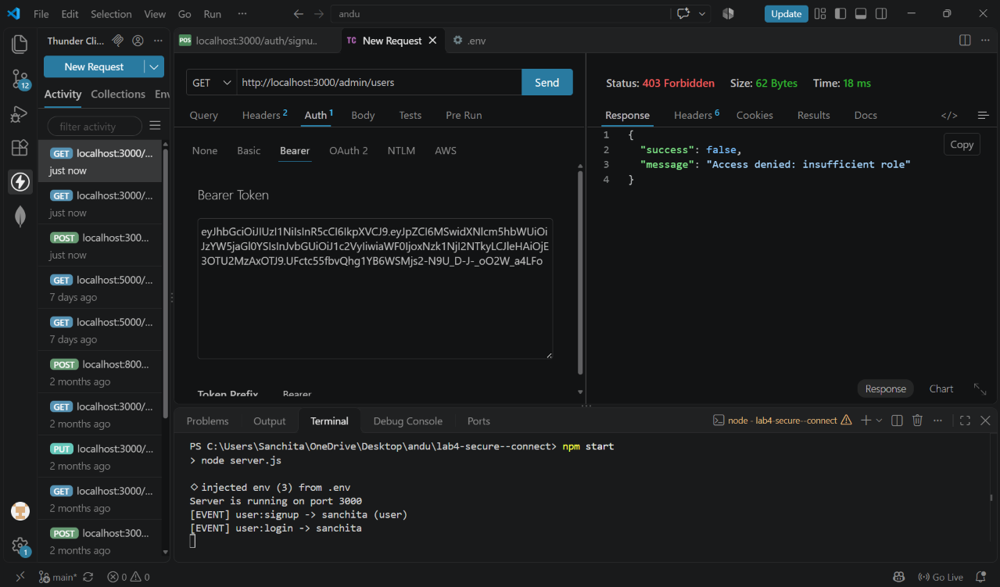
6.  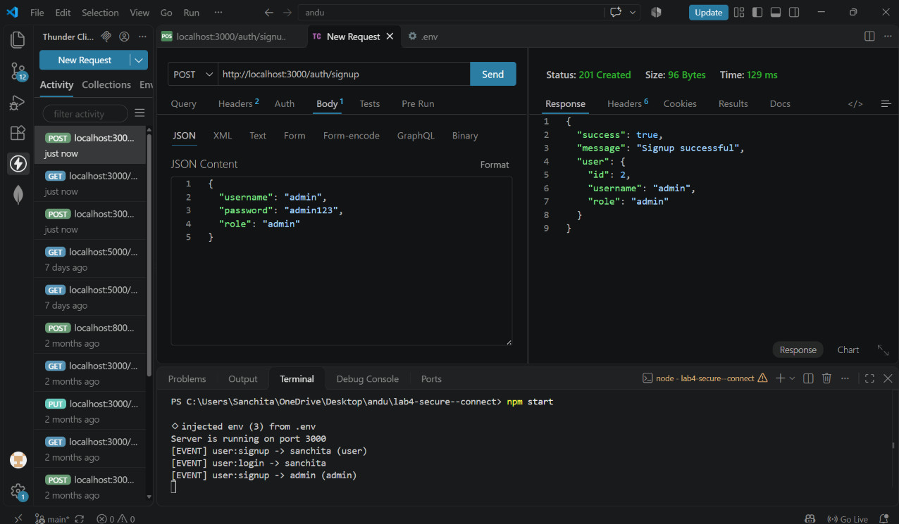
7.  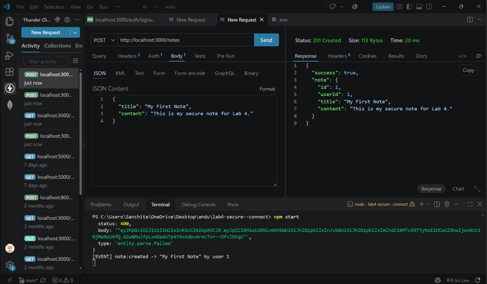
8.  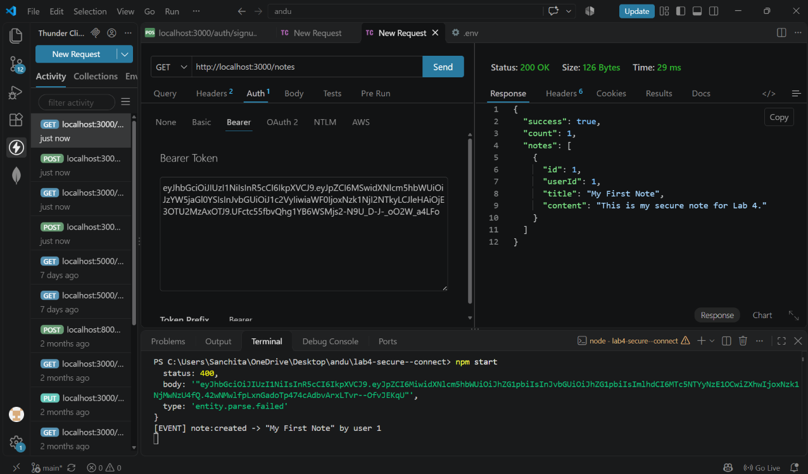
9.  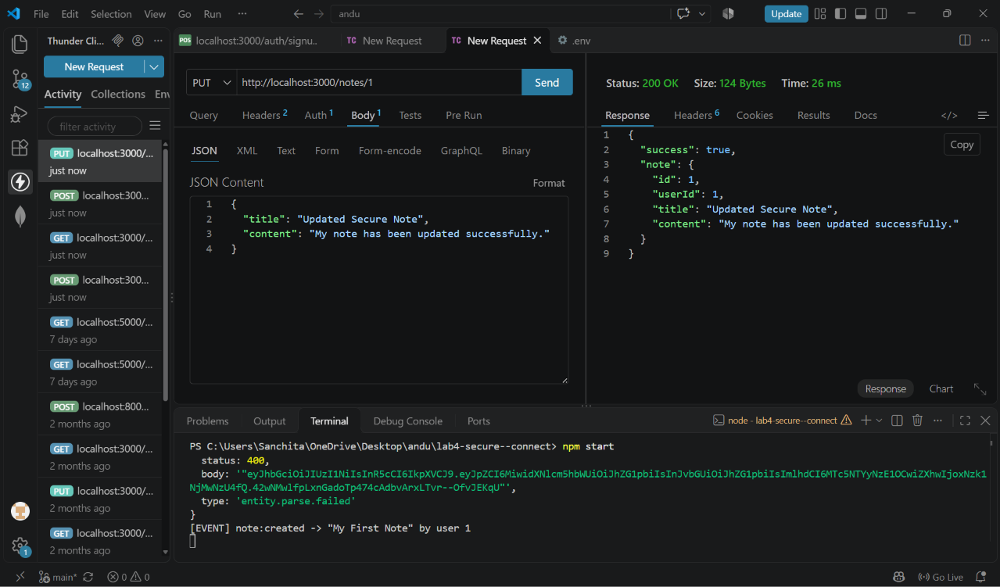
10. 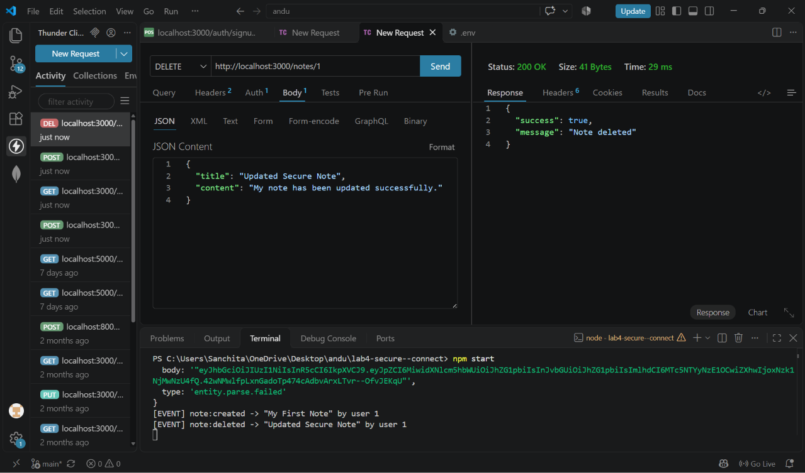
11. 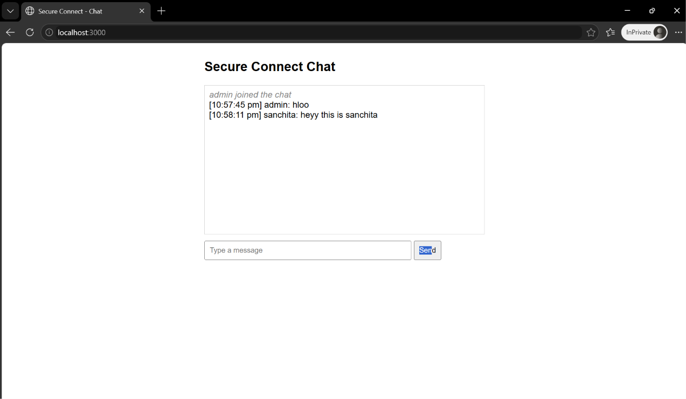
12. 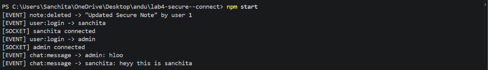
